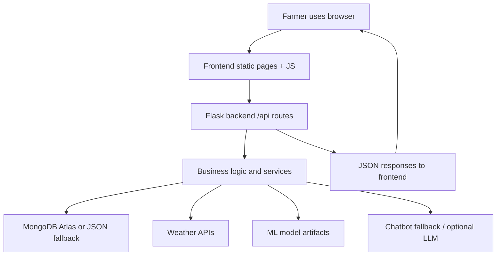

# SmartCrop Viva Preparation Guide

This document is based on the actual repository code in this project. I did not invent packages, functions, or features. Where something could not be verified, I clearly marked it as unknown or not found.

Important note: the repository does not currently contain a meaningful project README file. The file [README.md](README.md) exists but is empty (0 bytes), so the conclusions below are based on the source code, configuration files, HTML/JS frontend, and backend Python modules.

---

## 1. Project overview

### 1.1 Project title and purpose
The project is named SmartCrop. Based on the code, it is a Flask-based agriculture support system for Indian farmers. It combines:

- weather information and farm advisories
- crop recommendation logic
- soil analysis tools
- image-based pest detection
- crop calendar and government scheme information
- a farm assistant chatbot
- authenticated farmer profiles and dashboard

The purpose is to help farmers make practical decisions about crop choice, soil management, irrigation, pest control, and scheme awareness using a web application.

### 1.2 Problem statement
Farmers often need information from multiple sources: weather, soil health, local crop advice, insurance or subsidy schemes, and pest diagnosis. In many real situations, this information is fragmented across different websites, calls, local offices, and field experience. The project tries to centralize these functions into one farmer-friendly digital platform.

### 1.3 Why this project is needed
The code shows that the system is meant to reduce uncertainty before sowing, during crop growth, and before pest or irrigation decisions. It also tries to support farmers in local languages and through simple interface design.

### 1.4 Existing system and limitations
The system is a prototype web application. It does not claim to replace agricultural officers or laboratory soil testing. In code, the app clearly separates:

- live weather from Open-Meteo/OpenWeatherMap
- rule-based agronomy guidance
- optional AI/ML recommendation engines
- local fallback storage when MongoDB is unavailable

The app explicitly flags demo/weather fallback data and avoids pretending a model is live when it is not available.

### 1.5 Proposed system and advantages
The project proposes a single app where a farmer can:

- sign in and maintain a profile
- view a dashboard with local weather info
- upload soil values or images
- get crop recommendations
- detect pests from images
- see crop calendars and government schemes
- talk to a farm assistant in multiple languages

Advantages include convenience, unified farmer support, better decision-making, and easier extension for future services.

### 1.6 Main objectives
From the application structure, the main objectives are:

1. Provide weather and crop guidance to farmers.
2. Help with soil nutrient analysis and crop suitability.
3. Support image-based pest detection.
4. Give timely crop-calendar reminders.
5. Expose agriculture schemes and eligibility information.
6. Offer a simple AI chat assistant for common farming questions.
7. Keep the app usable even if MongoDB is unavailable through a local JSON fallback.

### 1.7 Target users
The code clearly targets farmers, especially Indian farmers. The assistant is described as an AI farming assistant for Indian farmers and the app includes Indian agriculture concepts, schemes, and local-language support.

### 1.8 Key features and functionality
Verified features in the code:

- user registration and login with session-based auth
- weather current conditions and 7-day forecast
- weather-based farming advice
- crop recommendation using a trained ML model and fallback logic
- soil nutrient analysis using agronomy reference ranges
- soil photo visual classification
- pest image detection using scikit-learn model and guidance
- crop calendar based on crop + season
- government scheme lookup
- chatbot with knowledge-base fallback and optional LLM integration
- dashboard summary for the farmer

### 1.9 Scope and limitations
Scope:

- prototype agriculture management platform
- mostly web-based frontend served by Flask
- works for specific Indian agriculture use cases

Limitations:

- no real deployment configuration or production-ready hosting setup in the repository
- no formal test suite in the main project
- some ML components depend on artifacts and trained files being present
- demo fallback data is intentionally used for offline/unavailable services
- not all scheme data is fully complete for every state

### 1.10 Real-world applications
This project is useful for:

- small and medium farmers
- agricultural extension officers
- rural technology pilots
- digital agriculture platforms in India
- farmer education and advisory services

### 1.11 What makes it different from similar projects
From the code, SmartCrop is different because it combines many farm tasks in one app:

- weather + soil + pest + crop + schemes + chatbot
- simple farmer-friendly language and response structure
- optional open-source external APIs instead of hard-coded values
- clean fallback behavior when network or database services are unavailable

### 1.12 Smart 30-second, 1-minute, 3-minute viva answers

30-second answer:

“SmartCrop is an agriculture support web application for farmers. It helps them check weather, analyze soil, get crop recommendations, detect pest problems from images, see crop calendars, and find government schemes. The system uses Flask for the backend, plain HTML/CSS/JS for the frontend, and optional MongoDB storage with a JSON fallback. It is designed to help farmers make better decisions with digital tools.”

1-minute answer:

“SmartCrop is a farmer-focused agriculture decision support system. It combines weather data, crop recommendations, soil analysis, pest detection, and government scheme information into one application. Farmers can register, log in, fill their profile, and get personalized guidance. The backend is built in Python with Flask, while the frontend is a static HTML/JavaScript interface. The app supports live services through Open-Meteo and optional OpenWeatherMap, while also falling back to demo data when the services are unavailable. It stores data in MongoDB when available and in a local JSON store otherwise.”

3-minute answer:

“The project addresses a common problem in agriculture: farmers often get information from multiple disjoint sources and make critical decisions without a unified advisory system. SmartCrop centralizes several tasks in one platform. The user registers and logs in, then visits weather, crop, soil, pest, and scheme pages. The weather service fetches live data from Open-Meteo and uses OpenWeatherMap only if an API key is configured. The crop recommendation logic uses a RandomForest model trained on crop agronomy data, while soil analysis follows rule-based agronomy ranges. Pest detection uses uploaded images and a trained classifier, and the chatbot offers an offline knowledge-based assistant or an optional LLM when configured. All data is stored in MongoDB Atlas when reachable, otherwise the project silently falls back to a JSON file so the app remains usable in demos and local setups. The app is implemented as a Flask backend and a static frontend with JavaScript modules for API calls, navigation, and data display. Its real value is in making agricultural information more accessible and farmer-friendly.”

---

## 2. Technology stack and package analysis

Below is the actual stack observed in the project.

| Item | Purpose | Why it was chosen | Where it is used | Alternative |
|---|---|---|---|---|
| Python | Main backend language | Easy for Flask, data processing, ML, and API services | [app.py](app.py), [backend/__init__.py](backend/__init__.py), all backend routes and models | Java, Node.js, C# |
| Flask | Web framework for backend APIs and static pages | Simple, lightweight, ideal for small web apps and API services | [backend/__init__.py](backend/__init__.py), route files under [backend/routes](backend/routes) | Django, FastAPI |
| HTML/CSS/JavaScript | Frontend UI and interactions | No heavy build setup; easy to serve from Flask | [frontend](frontend) static pages and [frontend/js](frontend/js) | React/Vue |
| MongoDB Atlas / PyMongo | Primary database | Scales well for structured farm data and user records | [backend/models/mongo.py](backend/models/mongo.py), [backend/models/db.py](backend/models/db.py) | SQLite, PostgreSQL |
| Python dotenv | Load environment variables | Keeps secrets and config out of source code | [config.py](config.py) | manual env loading |
| Pandas | Data manipulation for ML and dataset handling | Common for tabular agriculture data | [backend/ml/crop_recommendation/model.py](backend/ml/crop_recommendation/model.py) | NumPy alone, Polars |
| NumPy | Numerical arrays and image processing | Needed for model input and pixel arrays | [backend/ml/pest_detection/classifier.py](backend/ml/pest_detection/classifier.py), [backend/ml/soil_analysis/analyzer.py](backend/ml/soil_analysis/analyzer.py) | pure Python lists |
| scikit-learn | RandomForest, train/test split, model pipeline | Standard ML library for classification | [backend/ml/crop_recommendation/model.py](backend/ml/crop_recommendation/model.py), [backend/ml/pest_detection/train.py](backend/ml/pest_detection/train.py) | XGBoost, TensorFlow |
| Joblib | Save/load trained model artifacts | Common format for sklearn model persistence | [backend/ml/crop_recommendation/model.py](backend/ml/crop_recommendation/model.py), [backend/ml/pest_detection/classifier.py](backend/ml/pest_detection/classifier.py) | pickle |
| Pillow | Image manipulation and conversion | Used to open and convert uploaded images | [backend/routes/pest.py](backend/routes/pest.py), [backend/routes/soil.py](backend/routes/soil.py) | OpenCV |
| Requests | HTTP calls to weather APIs | Easy integration with remote services | [backend/services/weather_service.py](backend/services/weather_service.py) | httpx, aiohttp |
| Werkzeug | Password hashing and session utilities | Secure password handling and framework utilities | [backend/models/users.py](backend/models/users.py) | bcrypt direct usage |
| Open-Meteo | Live weather and geocoding | Free and keyless; good for public weather data | [backend/services/weather_service.py](backend/services/weather_service.py) | OpenWeatherMap |
| OpenWeatherMap | Secondary weather API | Optional richer API when a key is set | [backend/services/weather_service.py](backend/services/weather_service.py) | Open-Meteo alone |
| JSON file store | Local fallback persistence | Keeps app usable without MongoDB | [backend/models/db.py](backend/models/db.py) | SQLite |
| Gunicorn / runtime commands | Not clearly configured in repo | Typically used in deployment but not necessary for local app startup | not verified in repo | Nginx + Flask server |
| Git / environment config | Project versioning and secret management | Keeps project portable and secure | [.env.example](.env.example), [.env](.env) | secrets embedded in code |

### Important dependencies explained

#### Flask
Flask is the core web framework. It is used to create the app, register blueprints, handle routes, serve static pages, and return JSON responses. Example from [backend/__init__.py](backend/__init__.py):

```python
app = Flask(__name__, static_folder=None)
app.config.from_object(Config)
```

If Flask were removed, the app would not be able to expose the APIs and UI routes.

#### PyMongo
PyMongo is used to connect to MongoDB Atlas when configured. The app tries a ping on startup and falls back when unavailable. Example from [backend/models/mongo.py](backend/models/mongo.py):

```python
_client = MongoClient(uri, serverSelectionTimeoutMS=4000, connect=False)
```

If this were removed, the app would lose MongoDB connectivity support.

#### scikit-learn
Used for classification tasks. The crop recommendation model is a RandomForest classifier and the pest classifier uses a trained sklearn model artifact. Example from [backend/ml/crop_recommendation/model.py](backend/ml/crop_recommendation/model.py):

```python
from sklearn.ensemble import RandomForestClassifier
```

Without scikit-learn, the trained recommendation and pest detection logic would not run as designed.

#### requests
Used to call external APIs and geocoding services. Example from [backend/services/weather_service.py](backend/services/weather_service.py):

```python
response = requests.get(OM_FORECAST, params=params, timeout=15)
```

Without it, live weather access would fail.

#### Pillow
Used to convert uploaded images to RGB arrays for analysis. Example from [backend/routes/pest.py](backend/routes/pest.py):

```python
rgb = np.asarray(Image.open(filepath).convert("RGB"), dtype=np.float32)
```

Without Pillow, image upload analysis would not work.

#### pandas / numpy
Pandas organizes the crop dataset; NumPy helps convert images and feature vectors into data arrays. These are necessary for model training and inference.

#### python-dotenv
Loads `.env` values. Example from [config.py](config.py):

```python
load_dotenv()
```

This is essential for keeping configuration and secrets separate from code.

#### Werkzeug security
Hashing and password validation are handled here. Example from [backend/models/users.py](backend/models/users.py):

```python
from werkzeug.security import check_password_hash, generate_password_hash
```

This is used to store secure user credentials and verify logins.

### Direct vs transitive dependencies

Direct dependencies from `requirements.txt` include:

- Flask
- pandas
- numpy
- scikit-learn
- joblib
- requests
- python-dotenv
- pymongo
- Pillow

Development/test dependencies are not clearly configured in the main project. A search did not find a formal pytest or unittest suite in the active application code.

---

## 3. File-by-file project explanation

### Directory tree

```text
SmartCrop/
├── app.py
├── config.py
├── .env.example
├── .env
├── requirements.txt
├── crop_yield_dataset.csv
├── artifacts/
│   └── crop_recommender.joblib
├── data/
├── instance/
├── frontend/
│   ├── css/
│   ├── js/
│   ├── assets/
│   ├── index.html
│   ├── dashboard.html
│   ├── weather.html
│   ├── crop-recommendation.html
│   ├── soil.html
│   ├── pest-detection.html
│   ├── crop-calendar.html
│   ├── schemes.html
│   ├── chatbot.html
│   ├── profile.html
│   ├── login.html
│   ├── register.html
│   └── 404.html
├── backend/
│   ├── __init__.py
│   ├── seed.py
│   ├── chatbot/
│   ├── ml/
│   ├── models/
│   ├── routes/
│   ├── services/
│   └── utils/
├── legacy/
│   └── older experimental code
├── models/
├── static/
└── fixora-store/
```

### Important files and their roles

#### [app.py](app.py)
Purpose: entry point for the Flask app.

```python
from backend import create_app

app = create_app()

if __name__ == "__main__":
    app.run(host="0.0.0.0", port=5000, debug=app.config["DEBUG"])
```

This file starts the server on port 5000.

#### [config.py](config.py)
Purpose: central environment configuration.

- loads `.env`
- defines Flask settings
- provides API keys, database options, and upload limits
- keeps secrets out of source code

#### [backend/__init__.py](backend/__init__.py)
Purpose: app factory and route registration.

- creates the Flask app
- loads app config
- initializes the data store
- seeds reference data
- registers all API blueprints
- serves frontend pages
- adds security headers

#### [backend/models/db.py](backend/models/db.py)
Purpose: database abstraction layer.

- uses MongoDB if available
- otherwise stores data in a JSON file
- manages schema-like collections like users, farms, crop recommendations, pest reports, and chat history

#### [backend/models/users.py](backend/models/users.py)
Purpose: user account logic.

- password hashing with Werkzeug
- create user, authenticate, update user, get by email/id
- returns public user data without passwords

#### [backend/routes/auth.py](backend/routes/auth.py)
Purpose: login/register/logout endpoints.

- `/api/auth/register`
- `/api/auth/login`
- `/api/auth/logout`
- `/api/auth/me`
- `/api/auth/status`

#### [backend/routes/weather.py](backend/routes/weather.py)
Purpose: current and forecast weather API.

- returns conditions for a location or coordinates
- supports forecast and advisory endpoints

#### [backend/routes/crop.py](backend/routes/crop.py)
Purpose: crop recommendation endpoint.

- accepts crop inputs
- calls recommendation model
- stores recommendation result in database

#### [backend/routes/soil.py](backend/routes/soil.py)
Purpose: soil analysis and image-based soil visual checking.

- accepts entered soil values
- returns NPK/pH interpretation
- supports image upload for visual classification

#### [backend/routes/pest.py](backend/routes/pest.py)
Purpose: image pest detection endpoint.

- validates uploaded image
- calls classifier
- saves pest report to database

#### [backend/routes/chat.py](backend/routes/chat.py)
Purpose: AI farm assistant.

- sends message to LLM if configured
- otherwise uses offline knowledge-based fallback
- saves chat history

#### [backend/routes/calendar.py](backend/routes/calendar.py)
Purpose: crop calendar data.

- canonicalizes crop names
- returns crop phases for a crop/season
- persists user’s selected crop calendar

#### [backend/routes/schemes.py](backend/routes/schemes.py)
Purpose: government scheme listing and detail routes.

- filters by category or query
- returns scheme details from seeded data

#### [backend/routes/dashboard.py](backend/routes/dashboard.py)
Purpose: aggregated dashboard response.

- combines weather, crop, soil, pest, notification info
- personalizes based on the farmer profile

#### [backend/services/weather_service.py](backend/services/weather_service.py)
Purpose: actual weather integration logic.

- uses Open-Meteo geocoding and forecast service
- falls back to OpenWeatherMap if key exists
- uses demo values if API fails

#### [backend/ml/crop_recommendation/model.py](backend/ml/crop_recommendation/model.py)
Purpose: crop recommendation ML and agronomy guidance.

- loads trained model artifact
- builds ML feature vectors
- returns crop suggestion and guidance

#### [backend/ml/pest_detection/classifier.py](backend/ml/pest_detection/classifier.py)
Purpose: pest detection classifier and guidance.

- loads trained pest classifier artifact
- classifies uploaded plant images
- gives farmer-friendly action/therapy messages

#### [backend/ml/soil_analysis/analyzer.py](backend/ml/soil_analysis/analyzer.py)
Purpose: soil health logic.

- converts values into low/medium/high status
- uses agronomy reference ranges
- recommends treatment based on pH and NPK values

#### [backend/seed.py](backend/seed.py)
Purpose: government schemes and crop-calendar knowledge base.

- seeds central government scheme records
- defines crop phases and seasonal timelines

#### [frontend/js/api.js](frontend/js/api.js)
Purpose: one centralized API layer for frontend requests.

- all fetch calls are routed here
- prevents repeated request logic in each page

#### [frontend/js/main.js](frontend/js/main.js)
Purpose: shared layout and auth navigation logic.

- renders header/footer/navigation
- handles language selector
- handles auth guard when needed

---

## 4. Important code snippets and explanations

### Snippet 1: Application entry point
File: [app.py](app.py)

```python
from backend import create_app

app = create_app()

if __name__ == "__main__":
    app.run(host="0.0.0.0", port=5000, debug=app.config["DEBUG"])
```

Explanation:

- `from backend import create_app` imports the Flask app factory.
- `app = create_app()` sets up the app configuration, database, routes, and pages.
- `app.run(...)` starts the development server on port 5000.

Viva questions:

1. Why is `create_app()` a better design than putting everything in one file?
   - It keeps configuration, routing, and app setup modular and easier to test.
2. Why is port 5000 used?
   - It is the default Flask development port and is commonly used for local apps.
3. What is the purpose of `DEBUG`?
   - It turns on developer debugging when running in development mode.

### Snippet 2: App factory and blueprint registration
File: [backend/__init__.py](backend/__init__.py)

```python
app = Flask(__name__, static_folder=None)
app.config.from_object(Config)

from .routes import auth, profile, weather, crop, soil, pest, chat, calendar, schemes, dashboard
for bp in (...):
    app.register_blueprint(bp, url_prefix="/api")
```

Explanation:

- The app is built with Flask.
- It loads the configuration object from [config.py](config.py).
- Each route module is a blueprint that is attached under `/api`.
- This design keeps endpoints organized by feature.

Viva questions:

1. What is a blueprint?
   - A blueprint organizes routes logically and can be registered into the app later.
2. Why is `/api` prefix used?
   - It clearly separates the backend API from static HTML pages.

### Snippet 3: User registration
File: [backend/routes/auth.py](backend/routes/auth.py)

```python
if len(password) < 6:
    return error("Password must be at least 6 characters", 400)

user = users.create_user(name, email, password, location=location,
                         language=language, state=state, district=district)

session["user_id"] = user["id"]
```

Explanation:

- Input is validated before creating an account.
- The password length check is a simple validation rule.
- `create_user` stores the record in the active datastore.
- The session stores the logged-in user ID for secure, later requests.

Viva questions:

1. What is the purpose of `session["user_id"]`?
   - It keeps the user authenticated across requests.
2. Why validate password length on the server?
   - It prevents weak passwords and keeps business rules consistent.

### Snippet 4: User model hashing
File: [backend/models/users.py](backend/models/users.py)

```python
from werkzeug.security import check_password_hash, generate_password_hash

user = {
    "password_hash": generate_password_hash(password),
}
```

Explanation:

- Plain text passwords should never be stored.
- `generate_password_hash` creates a one-way hash.
- Authentication later compares hashed values.

Viva questions:

1. Why is hashing safer than storing plain text?
   - If the database is exposed, passwords are protected.
2. How is login verified?
   - The system compares the input password with the stored hash using `check_password_hash`.

### Snippet 5: Database fallback design
File: [backend/models/db.py](backend/models/db.py)

```python
def init_store(use_fallback=True, store_path=None):
    client = mongo.get_client()
    if client is not None:
        try:
            client.admin.command("ping")
            _store = MongoStore(client, mongo.get_db_name())
            _available = True
            return _store
        except Exception:
            pass
    if not use_fallback:
        raise RuntimeError("MongoDB Atlas is not reachable and local fallback is disabled")
```

Explanation:

- The app first attempts MongoDB.
- If MongoDB is not reachable, it falls back to a local JSON store.
- This is a resilience feature that keeps the app usable in local setups.

Viva questions:

1. Why is fallback important for a demo or prototype?
   - It avoids failure when cloud services are unavailable.
2. What does `client.admin.command("ping")` do?
   - It checks whether MongoDB is reachable.

### Snippet 6: Weather service with Open-Meteo
File: [backend/services/weather_service.py](backend/services/weather_service.py)

```python
OM_GEO = "https://geocoding-api.open-meteo.com/v1/search"
OM_FORECAST = "https://api.open-meteo.com/v1/forecast"

response = requests.get(OM_FORECAST, params=params, timeout=15)
response.raise_for_status()
```

Explanation:

- Open-Meteo is used for geocoding and forecast requests.
- Live weather data is fetched using HTTP GET requests.
- The code handles network issues gracefully and may fall back to demo values.

Viva questions:

1. Why use a geocoding service?
   - To convert a location name into latitude and longitude so weather APIs can query the correct place.
2. Why is `raise_for_status()` important?
   - It raises an exception when the remote server responds with an error code.

### Snippet 7: Crop recommendation model
File: [backend/ml/crop_recommendation/model.py](backend/ml/crop_recommendation/model.py)

```python
_FEATURES = ["temperature", "humidity", "rainfall", "ph", "nitrogen", "phosphorus", "potassium"]
model = RandomForestClassifier(n_estimators=200, random_state=42)
model.fit(X_train, y_train)
```

Explanation:

- The crop recommendation system uses soil and weather features as input.
- A RandomForest classifier is an ensemble learning algorithm used for classification.
- It learns which crop label fits the provided farm conditions.

Viva questions:

1. Why RandomForest?
   - It is a standard and effective classifier for tabular agricultural data.
2. Why are the features listed explicitly?
   - The model expects the same feature order each time it predicts.

### Snippet 8: Soil analysis logic
File: [backend/ml/soil_analysis/analyzer.py](backend/ml/soil_analysis/analyzer.py)

```python
def classify(value, low, medium, unit=""):
    if value < low:
        return "low", "Low", _percent(value, 0, low), unit
    if value <= medium:
        return "medium", "Medium", _percent(value, low, medium), unit
    return "high", "High", 100, unit
```

Explanation:

- Soil values are categorized into low/medium/high ranges.
- This is a simple agronomy-based classification service rather than full scientific simulation.
- It produces guidance for nitrogen, phosphorus, potassium, and pH.

Viva questions:

1. Why does this logic use threshold ranges?
   - Because agronomy advice often depends on ideal nutrient ranges.
2. Is it a machine-learning algorithm?
   - Not in this implementation; it is rule-driven classification.

### Snippet 9: Pest detection image validation and model use
File: [backend/routes/pest.py](backend/routes/pest.py)

```python
filename, error_msg = validate_image(file)
if error_msg:
    return error(error_msg, 400)

result, confidence = classifier.detect_from_image(rgb)
```

Explanation:

- The app validates the uploaded image type and size first.
- The image is converted to an RGB pixel array.
- A trained classifier evaluates the image and returns a pest label and confidence.

Viva questions:

1. Why validate the image before processing?
   - To reduce invalid uploads, reduce server errors, and keep the pipeline safe.
2. Why is image size checked?
   - To avoid excessive upload sizes and memory problems.

### Snippet 10: Offline knowledge-based chatbot fallback
File: [backend/chatbot/fallback.py](backend/chatbot/fallback.py)

```python
def _classify(message):
    text = _normalize(message)
    if any(k in text for k in ["soil", "khad", "fertilizer", "fertiliser", "nutrient"]):
        return "soil"
```

Explanation:

- The chatbot looks for keywords in the farmer’s message.
- It classifies the message into categories such as weather, crop, pest, or scheme.
- If no LLM is configured, this fallback answers common agriculture questions.

Viva questions:

1. Why is fallback logic useful?
   - It keeps the application functional even when an external LLM is unavailable.
2. Why is keyword-based logic limited?
   - It cannot understand every possible farm question as flexibly as an LLM.

---

## 5. Architecture and data flow

### High-level architecture



### Execution flow from start to finish

1. The app starts from [app.py](app.py), which calls `create_app()`.
2. The app factory imports configuration and registers routes.
3. The app initializes the database store:
   - uses MongoDB if available
   - otherwise falls back to a local JSON file
4. The frontend pages are served as static HTML and JavaScript.
5. The farmer sends requests from the browser to `/api/...` endpoints.
6. The route logic validates user input and calls the correct service or model.
7. The service interacts with weather APIs, ML models, or database collections.
8. The system returns JSON results to the frontend, which updates the page.
9. Errors are converted to simple JSON `{ "error": ... }` responses and not exposed as full stack traces.

### Data flow for an important feature: crop recommendation

1. Farmer enters values such as temperature, humidity, rainfall, soil pH, and NPK in the crop recommendation page.
2. The frontend sends a POST request to `/api/crop/recommend`.
3. [backend/routes/crop.py](backend/routes/crop.py) calls `recommend_crop(data)`.
4. [backend/ml/crop_recommendation/model.py](backend/ml/crop_recommendation/model.py) prepares the feature vector and asks the trained model for a crop label.
5. Guidance text is added using the crop knowledge dictionary.
6. The result is returned to the browser and also stored in the `crop_recommendations` collection/document.

### Data flow for an important feature: pest detection

1. Farmer uploads an image on the pest detection page.
2. The frontend sends form-data to `/api/pest/detect`.
3. [backend/routes/pest.py](backend/routes/pest.py) validates the file type and size.
4. The image is converted using Pillow into a NumPy array.
5. The classifier checks whether the image is a pest/plant matching class.
6. The prediction and confidence are returned to the farmer.
7. The result is saved in the `pest_reports` collection.

### Frontend, backend, database, and service layering

- Frontend: static HTML + JS pages in [frontend](frontend)
- Backend: Flask app and blueprints in [backend](backend)
- Models: database and user logic in [backend/models](backend/models)
- Service layer: weather integration and custom business logic in [backend/services](backend/services)
- ML layer: crop recommendation, soil analysis, pest detection under [backend/ml](backend/ml)
- Data store: MongoDB Atlas or JSON fallback in [backend/models/db.py](backend/models/db.py)

---

## 6. Database and data management

### Database type and design
The project is designed to use MongoDB Atlas as the primary database, but it gracefully falls back to a local JSON file when MongoDB is unavailable.

This is verified in:

- [backend/models/mongo.py](backend/models/mongo.py)
- [backend/models/db.py](backend/models/db.py)
- [config.py](config.py)

### Database collections observed in the code
The `COLLECTIONS` tuple in [backend/models/db.py](backend/models/db.py) includes:

- users
- farms
- chat_history
- soil_reports
- crop_recommendations
- pest_reports
- crop_calendar
- government_schemes
- notifications

### Example data model logic
User creation logic in [backend/models/users.py](backend/models/users.py):

```python
def create_user(name, email, password, phone="", location="", language="en",
                state="", district=""):
    user = {
        "id": _next_user_id(store),
        "name": (name or "").strip(),
        "email": email,
        "password_hash": generate_password_hash(password),
        "location": (location or "").strip(),
        "state": (state or "").strip(),
        "district": (district or "").strip(),
        "language": language,
        "role": "farmer",
    }
```

This shows a document-based model where each user is a JSON-like record with stored profile values.

### CRUD operations and usage
The file store implements simplified Mongo-like methods:

- `insert()`
- `find()`
- `find_one()`
- `update()`
- `delete()`
- `insert_many()`
- `replace()`

Examples from [backend/models/db.py](backend/models/db.py):

```python
def find_one(self, collection, query=None, sort=None):
    rows = self.find(collection, query, sort=sort, limit=1)
    return rows[0] if rows else None
```

and

```python
def update(self, collection, query, update, upsert=False):
    result = self.db[collection].update_many(query, {"$set": update}, upsert=upsert)
```

### Persistence behavior
The app persists:

- farmer registration and profile details
- weather-related records if needed
- crop recommendations
- soil analyses
- pest reports
- saved crop calendar preference
- chat messages
- scheme information from seeds

### Security and data handling
The app does not expose stack traces in API errors. It uses `@app.errorhandler` to return safe JSON errors. Example from [backend/__init__.py](backend/__init__.py):

```python
@app.errorhandler(500)
def server_error(error):
    app.logger.exception("Unhandled error: %s", error)
    if request_is_api():
        return jsonify({"error": "An unexpected error occurred. Please try again."}), 500
```

This is a good security and UX practice for a production-facing application.

---

## 7. Algorithms and technical concepts used

### 1. RandomForest classification
Where: [backend/ml/crop_recommendation/model.py](backend/ml/crop_recommendation/model.py)

- A RandomForest is an ensemble of decision trees.
- It is used to classify a farmer’s crop recommendation based on temperature, humidity, soil nutrients, and rainfall.
- It is suitable for tabular data and generally handles nonlinear relationships well.

Advantages:

- good with tabular data
- stable and easy to explain compared with some deep learning models
- simple to persist with joblib

Limitations:

- depends on quality of the training data
- may not adapt perfectly to all local agro-climatic conditions

### 2. Rule-based agronomy classification
Where: [backend/ml/soil_analysis/analyzer.py](backend/ml/soil_analysis/analyzer.py)

- Inputs are compared against standard agronomy ranges for pH and NPK.
- Values are labeled as low, medium, or high.
- This is a practical agronomy-driven decision system.

Advantages:

- easy to understand
- transparent for farmer explanation
- good for educational or advisory app contexts

Limitations:

- not a scientific lab model
- cannot replace a real soil test

### 3. Image validation and preprocessing
Where: [backend/utils/helpers.py](backend/utils/helpers.py), [backend/routes/pest.py](backend/routes/pest.py)

- Uploaded files are validated by extension and file size.
- The file is converted to RGB arrays using Pillow.
- This ensures clean input for ML inference.

### 4. Session-based authentication
Where: [backend/routes/auth.py](backend/routes/auth.py), [backend/utils/helpers.py](backend/utils/helpers.py)

- The app uses Flask session management through `session["user_id"]`.
- This keeps the login state between requests.

### 5. External API integration with fallback
Where: [backend/services/weather_service.py](backend/services/weather_service.py)

- The app makes HTTP requests to Open-Meteo/OpenWeatherMap.
- If those fail, it returns clearly flagged demo data instead of pretending to be live data.

### 6. Document-based storage abstraction
Where: [backend/models/db.py](backend/models/db.py)

- The app creates a Mongo-like interface for both MongoDB and local JSON usage.
- This demonstrates a flexible database abstraction pattern.

### 7. RESTful API design
Where: route files under [backend/routes](backend/routes)

- API endpoints are feature-based and stateless.
- The frontend calls them using `fetch()`.
- The backend returns JSON with status codes.

### 8. Optional LLM integration
Where: [backend/chatbot/llm.py](backend/chatbot/llm.py)

- If `LLM_API_KEY` is present and `openai` is installed, the app uses a remote model.
- Otherwise, the app falls back to a knowledge-based assistant.

---

## 8. Installation, execution, and demonstration guide

### Prerequisites

- Python 3.10+ (the project uses modern Python packages)
- pip / virtual environment support
- access to environment variables or a `.env` file
- optional MongoDB Atlas access if you want live DB tasks

### Dependency installation
From the project root:

```powershell
python -m venv .venv
.\.venv\Scripts\Activate.ps1
pip install -r requirements.txt
```

### Environment setup
Copy [.env.example](.env.example) to `.env` and set variables such as:

- `SECRET_KEY`
- `FLASK_ENV`
- `MONGODB_URI` or Atlas credentials
- `DATABASE_NAME`
- `USE_LOCAL_FALLBACK`
- `LOCAL_STORE_PATH`
- `WEATHER_API_KEY` (optional)
- `LLM_API_KEY` (optional)
- `LLM_MODEL`
- `UPLOAD_DIR`

### Start the application

```powershell
python app.py
```

Then open:

- http://localhost:5000/

### Demo order
A good viva demonstration order is:

1. Home page and navigation
2. Registration/login flow
3. Weather page
4. Crop recommendation page
5. Soil analysis page
6. Pest detection page
7. Crop calendar page
8. Schemes page
9. Chatbot page
10. Dashboard page

### Expected output
The app should show a farmer dashboard and support pages. Weather and recommendations should return structured JSON responses, and the frontend should render them into user-friendly panels.

### Common issues and fixes

- MongoDB not working: app falls back to local JSON automatically.
- Missing environment variables: app still runs with defaults, but features may be limited.
- LLM key absent: chatbot uses fallback knowledge-based mode.
- Missing artifact or model file: crop/pest features may not work until the proper training artifact exists.
- Invalid image upload: the app returns a friendly validation error.

---

## 9. Testing and quality assurance

### What actually exists in the repository
I did not find a formal active unit testing suite in the main app files. A search across the main project did not reveal a clear `pytest` suite or standard test directory for the live application.

The `legacy` folder contains some older scripts and test-like examples, but they are not the current main project test environment.

### What the project does well
The code includes practical QA habits:

- input validation for registration, login, and image upload
- safe JSON error responses
- optional fallback behavior for weather and database services
- clear separation of handlers and business logic
- checking for model availability before doing pest detection

### What should be added
For a stronger production-quality project, these would be useful:

- unit tests for authentication flows
- tests for weather fallback logic
- tests for crop recommendation logic
- tests for soil analysis boundaries
- tests for pest detection validation
- integration tests for blueprint routes
- end-to-end tests for login and dashboard flows
- a CI pipeline for linting and tests

### Viva answer for testing
“Although the app has good validation and resilience in code, it does not appear to have a modern automated test suite in the main repository. The project does include data validation, safe error handling, and fallback patterns, but formal software testing should be added to improve reliability.”

---

## 10. Viva-ready summary

### Simple explanation of the project
SmartCrop is a digital agriculture assistant for farmers. It helps farmers make decisions on crop selection, soil health, weather, pest detection, crop calendar, and government schemes. The project uses Python and Flask for the backend, standard HTML/CSS/JavaScript for the frontend, and optional MongoDB or local JSON storage.

### Best 5 points to mention in the viva
1. It is a complete farmer support system in one app.
2. It combines weather, soil, crop, pest, and scheme data.
3. It uses Flask for APIs and modular route design.
4. It includes machine learning for crop recommendations and pest detection.
5. It is designed to remain usable even when database or external services are unavailable.

### Most likely viva questions and answers

Q1. What is the main problem your project solves?
A: Farmers often get important information from different sources. SmartCrop brings those decisions into one platform.

Q2. What technologies are used?
A: Python, Flask, HTML/CSS/JavaScript, MongoDB Atlas, scikit-learn, joblib, Pillow, requests, and JSON fallback storage.

Q3. What is the role of the backend?
A: The backend exposes APIs, validates input, processes business logic, consults models, and manages data storage.

Q4. Why is there a fallback local store?
A: To keep the app running when MongoDB Atlas is not available.

Q5. What is the main challenge or limitation?
A: The app is a useful prototype, but it needs a stronger test suite and more complete deployment configuration.

---

## 11. Final examiner-friendly answer (1 paragraph)

SmartCrop is an agricultural decision-support web application built to help Indian farmers manage weather, soil, crop planning, pest issues, and subsidy information in one place. The project uses a Flask backend, static frontend pages, and both MongoDB and JSON-based storage to keep the system functional in different environments. It includes a crop recommendation model, soil analysis logic, pest detection support, a crop calendar database, and a chatbot that can work with a knowledge base or optional LLM. The platform is designed to be simple, practical, and accessible for farmers who need clear guidance without juggling many different apps or services.

---

This viva guide is intentionally beginner-friendly and directly based on the repository code, without inventing features that are not actually implemented.
